# baseball-realtime-forecast — 研究紹介

**MLB（アメリカのプロ野球）の「次の1球」を予測して、試合を観ながら確かめられるようにする修士研究です。**

> 📌 **このリポジトリについて**
> 本リポジトリは研究内容と成果を紹介するためのものです。
> 研究成果の対外発表前であるため、指導教員の方針により**ソースコード・実験データは非公開**としています。
> 実装・実験・ドキュメントはすべて個人開発で行っています。
>
> 進捗の経緯と今後の計画は **[PROGRESS.md](PROGRESS.md)** にまとめています。

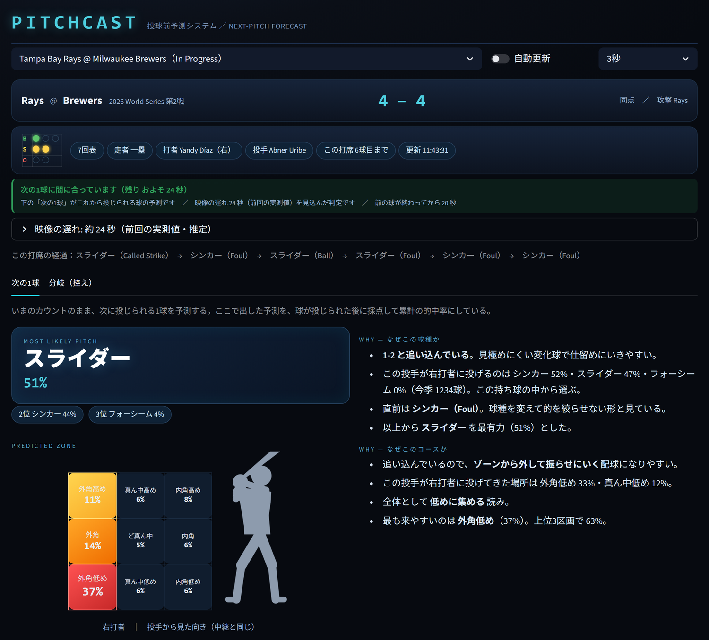

自作の観戦システム PITCHCAST の画面です。2026 年ワールドシリーズ第 2 戦の 7 回表を再現したもので、この球は実際にスライダーが外角低めに来ました。当たった場面を選んでいるので、いつもこう当たるわけではありません（4 試合通算の球種の的中率は 42.0%）。公開用に、打者のアイコンを差し替え、画面の一部を省いています。

野球の用語は[ページの下の方](#言葉の説明)にまとめました。

---

## どんな研究か

野球を観ていると、次は何を投げてくるのか、打者は振るのか、と毎球のように考えます。この研究では、それを機械学習で予測して、試合を観ながら画面で確かめられるようにしています。

学部の卒業研究では試合の勝敗を予測していました。修士ではこれを 1 球単位まで細かくして、MLB が公開している約 597 万球の計測データからモデルを作りました。そのモデルを使った観戦システム PITCHCAST も作り、2026 年のワールドシリーズで実際に動かしています。

最後に確かめたいのは、AI の読みを見ながら次の 1 球を考えると、試合がもっと面白くなるのかどうかです。こちらの評価はこれからです。

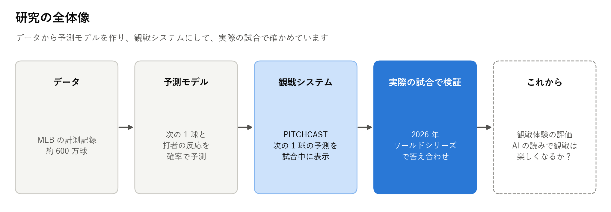

---

## 何を予測しているのか

打席の中では、投手が投げて、打者が振るかどうかを決めて、振れば空振りかファウルか前に飛ぶかが決まります。この順番に沿って、次に何が起きるかを予測します。

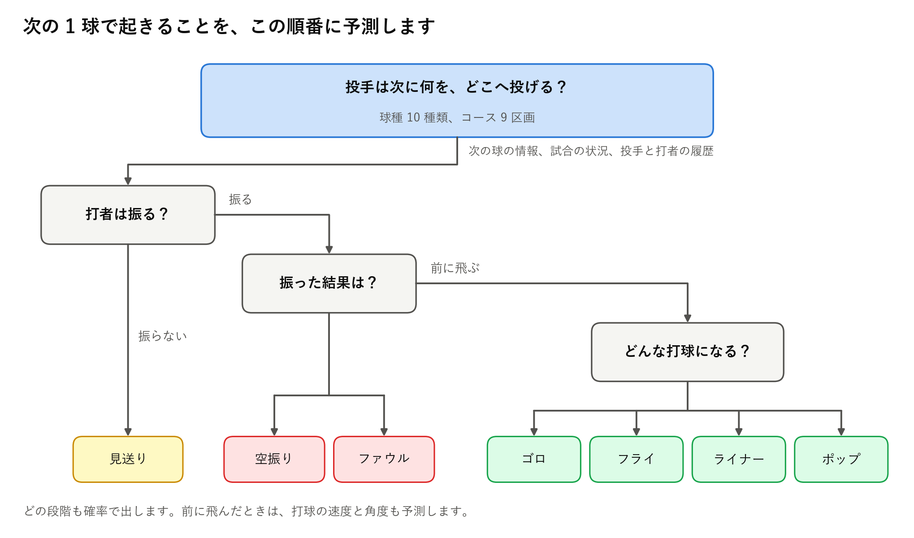

この図と「手法のしくみ」の図は、[Qiita の打席結果予測の記事](https://qiita.com/nffrrf0701/items/ab1bd5ad90b8773dbff7)の図の構成を参考に自作しました。

コースは、ストライクゾーンとその周りを 9 つの区画に分けて予測します。

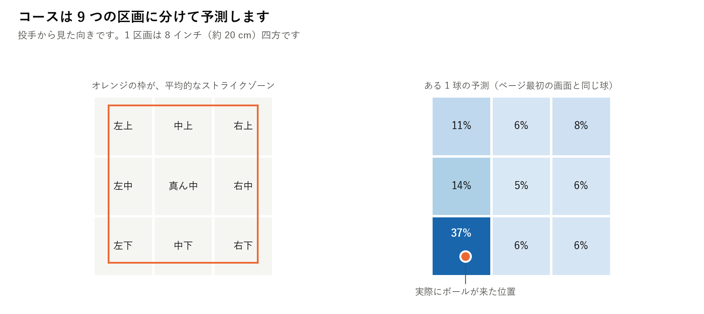

予測は「スライダー」と言い切らずに、「スライダー 51%、シンカー 44%」のように確率で出します。野球には偶然がつきものなので、どれくらい起こりそうかをそのまま見せるほうが、観ている人の役に立つと考えたからです。

確率は球ごとに動きます。下の打席では、同じ打者と投手の対戦でも、打者が振る確率がカウントと球によって 30% から 98% まで変わっています。

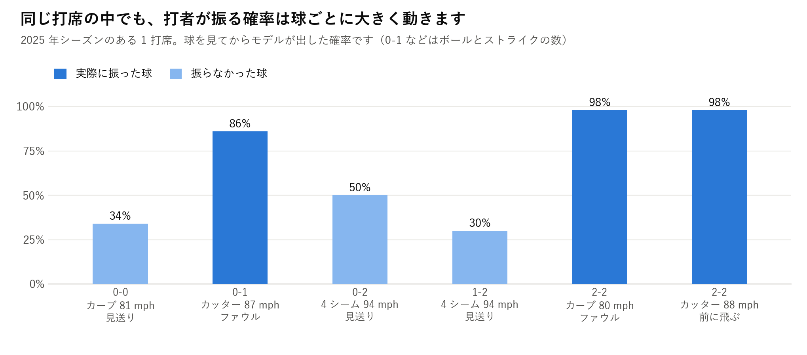

---

## 結果

学習に使っていない 2025 年シーズン（約 65〜66 万球）で、どれくらい当たるかを測りました。学習は 2024 年 6 月までのデータで行い、2024 年の残りで設定を調整しています。

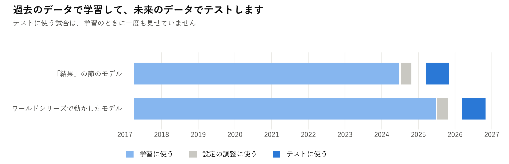

下の図と表の数字は、予測が当たった割合です。比べているのは、モデルを使わずに毎回同じ答えを言った場合に当たる割合です。たとえば 4 シーム（いわゆるストレート）は MLB でいちばん多く投げられる球種なので、毎回「4 シーム」と答えるだけでも 31.8% は当たります。何も考えなくてもこれだけ当たるので、モデルの実力はこの数字をどれだけ超えられるかで見ています。

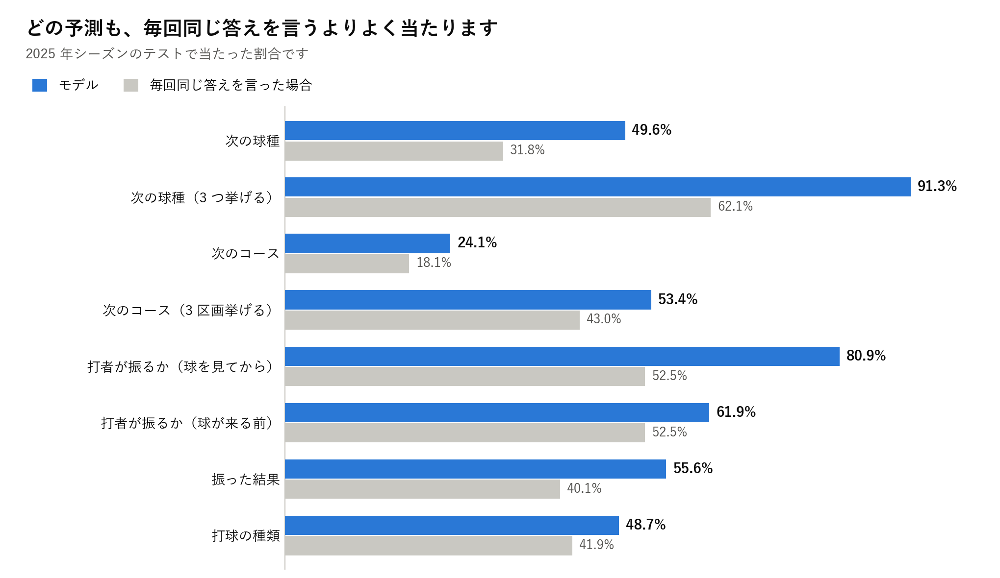

| 予測するもの | 選択肢の数 | モデルが当たった割合 | 比べる基準（毎回同じ答えを言った場合） |
|---|---|---|---|
| 次の球種 | 10 種類 | **49.6%** | 毎回「4 シーム」で 31.8% |
| 次の球種（確率の高い 3 つのどれかに入れば当たり） | 10 種類 | **91.3%** | 毎回、多い順に 3 種類で 62.1% |
| 次のコース | 9 区画 | **24.1%** | 毎回、いちばん多い区画で 18.1% |
| 次のコース（確率の高い 3 区画のどれかに入れば当たり） | 9 区画 | **53.4%** | 毎回、多い順に 3 区画で 43.0% |
| 打者が振るか（球を見てから） | 2 択 | **80.9%** | 毎回「振らない」で 52.5% |
| 打者が振るか（球が来る前） | 2 択 | **61.9%** | 毎回「振らない」で 52.5% |
| 振った結果（空振り、ファウル、前に飛ぶ） | 3 択 | **55.6%** | 毎回「ファウル」で 40.1% |
| 打球の種類（ゴロ、フライ、ライナー、ポップ） | 4 択 | **48.7%** | 毎回「ゴロ」で 41.9% |

「球を見てから」は、その球の球種やコースまで分かっている状態で打者の反応を当てる問題です。「球が来る前」はそれが分からないので、ずっと難しくなります。試合を観ながら使えるのは「球が来る前」のほうです。

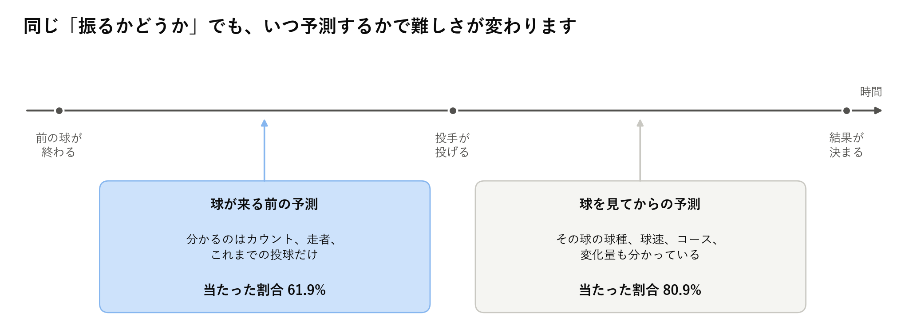

打球の速度と角度は数値で予測するので、当たった割合では測れません。ここでは R² という指標を使っていて、毎回平均を答えると 0、完全に当たると 1 になります。打球速度は 0.315、打球角度は 0.203 でした。

球種は確率の出来も調べました。「70% と出した球が本当に 7 割その球種になる」のが理想で、実際のずれは平均 1.4 ポイントでした。なお 49.6% は、モデルの組み合わせをテストの成績も見て選んだ値です。検証用のデータだけで選ぶと 49.2% になります。

---

## 分かったこと

### 打球に近づくほど偶然が大きくなる

振るかどうかは 8 割当たるのに、打球の種類は 5 割に届きません。同じように打ち返しても、ゴロになるときもあればライナーになるときもあるからです。ライナーは打球の 24% を占めますが、どの場面でもゴロかフライのほうが少しだけ確率が高く、1 位の答えとしてはほとんど選ばれません。

### 球種の精度を抑えていたのは配球の流行の変化だった

記憶力の高いモデルは、学習データでは 50% 近く当たるのに、未来のデータでは 45.9% まで落ちました。選手は入れ替わるし、配球の流行も変わるので、過去を覚えるだけでは通用しません。そこで場面ごとの配球の傾向を入れ、直近の試合を重く数える集計と毎月の更新を足すと、47.2% から 49.6% まで伸びました。

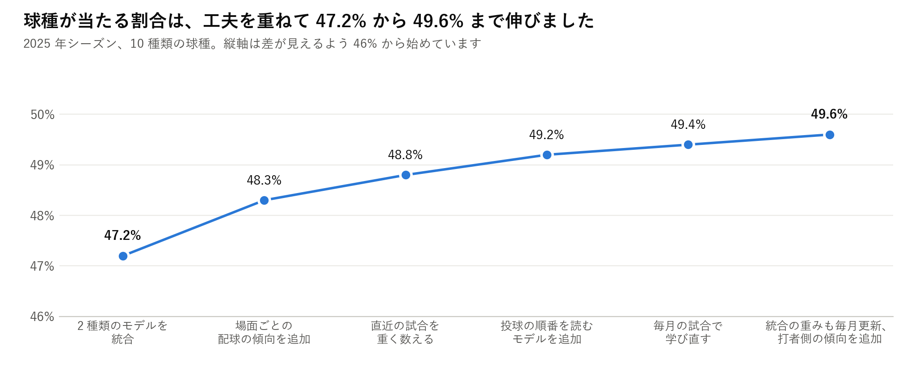

### 読みやすい投手と読みにくい投手がいる

持ち球が多くて配分も均等な投手は読みにくく、この差はシーズンをまたいでも続きます。カウントでも大きく変わり、3 ボール 0 ストライクなら 79.8% 当たります。モデルが自信を持っている球に絞るとさらに当たるようになり、当時のモデル（全球で 48.9%）では、半分の球に絞ると 60%、1 割に絞ると 80% でした。

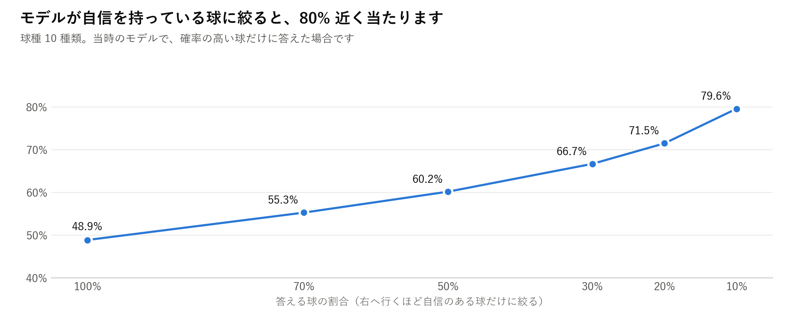

### コースは狙いが分かっていても当てきれない

全投球の 78.7% が区画の境界から 4 インチ以内に来るので、少しずれるだけで隣の区画に入ります。投手の制球のばらつきを 8 インチとすると、狙いを完全に知っていても、9 区画で当てられるのは 42.4% までです。

### 球が来る前に打者の反応を当てるのは難しい

次の球の予測と打者の反応の予測をつなげば、球が来る前でも反応を当てられるはずだと考えて、つなぎ方を 5 通り試しました。ところがどれも 62% 前後で変わりません。調べていくと、投球の位置を約 8 インチ（約 20 cm）より細かく当てられないと、つないでも専用のモデルに勝てないことが分かりました。今のコース予測はそこまで細かくありません。

---

## 手法のしくみ

細かい設定は省いて、考え方だけ書きます。

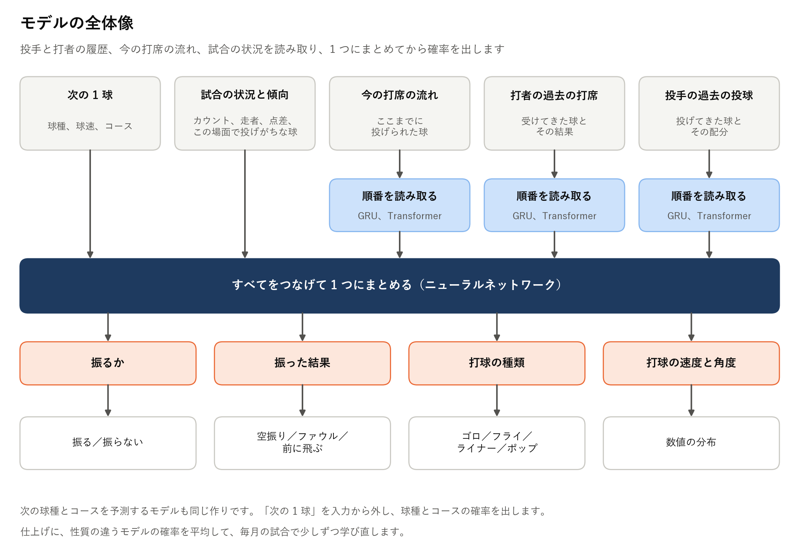

投手が最近投げた球、打者が最近受けた球、今の打席の流れを、文章を読むように順番のあるデータとして読み取ります。Transformer や GRU と呼ばれるニューラルネットワークを使っています。そこに「この投手はこのカウントで何を投げがちか」といった傾向を足します。傾向を数えるのはその試合より前のデータだけで、配球の流行は変わるので直近の試合を重く数えます。

コースは 1 点を当てにいかず、どこに来やすいかを確率の地図として出します。打者の反応のモデルは打席の流れどおりに学習させていて、振らなかった球では「振った結果」の誤差を計算しません。

仕上げに性質の違うモデルをいくつか混ぜて確率を平均し、毎月の試合で少しずつ学び直します。同じモデルを増やすより、違う情報を見るモデルを混ぜたほうがよく効きました。

---

## 観戦システム PITCHCAST

PITCHCAST は、テレビや配信で試合を観ている人に向けて作りました。ページの最初の画面がそれです。進行中の試合のデータを自動で取り込み、次の 1 球について、球種の確率を高い順に 3 つと、9 つの区画のどこに来そうかを出します。カウントや投手のこれまでの傾向をもとにした短い説明も添えていますが、モデルの内部を説明しているわけではありません。

映像の遅れは配信サービスや視聴環境で変わるはずなので、映像で投手がボールを離した瞬間にボタンを数回押すだけで、今の遅れを測り直せるようにしました。

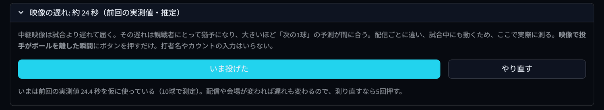

MLB のサーバーに負担をかけないよう、データの更新があったかどうかだけを 3 秒ごとに確かめて、更新があったときだけ試合全体のデータを取りに行く作りにしています。これで 1 試合の通信量は約 964 MB から約 35 MB に減りました。

放送で使われている配球 AI は「どう投げるべきか」を示すものが中心で、調べた範囲では、試合中に「次に何が来そうか」を投球前に確率で見せるものは見当たりませんでした。

---

## 実際の試合で確かめた

2026 年のワールドシリーズで、球が投げられる前に予測をファイルへ書き出しておき、結果が出てから採点しました。あとからデータを分けて評価するのと違って、未来の情報が混ざる余地がありません。

第 1 戦は記録プログラムを手で起動する作りにしていて、取り逃がしました。試合前に自動で動くように作り直し、第 2〜5 戦の 1,257 球を記録しています。動かしたのは計算の軽い単体のモデルで、上の 49.6% を出した統合モデルではありません。

### 当たったか

予測を出して採点できた 1,105 球の結果です。

| 予測の仕方 | モデル | その投手の傾向どおりに答える | MLB 全体で多い答えを言い続ける |
|---|---|---|---|
| 球種を 1 つ挙げる | **42.0%** | 40.5% | 28.1% |
| 球種を 3 つ挙げる | **81.2%** | 87.0% | 59.9% |
| コースを 1 区画挙げる | **17.6%** | 18.6% | 16.2% |
| コースを 3 区画挙げる | **42.7%** | 45.1% | 41.0% |

「その投手の傾向どおり」は、その投手が 2026 年シーズン（10 月 17 日まで）に最も多く投げた球種やコースを毎回答えた場合です。3 つ挙げるときは多い順に 3 つ答えます。一番右の列は、2025 年までの MLB 全体で多かった答えを毎回言った場合です。

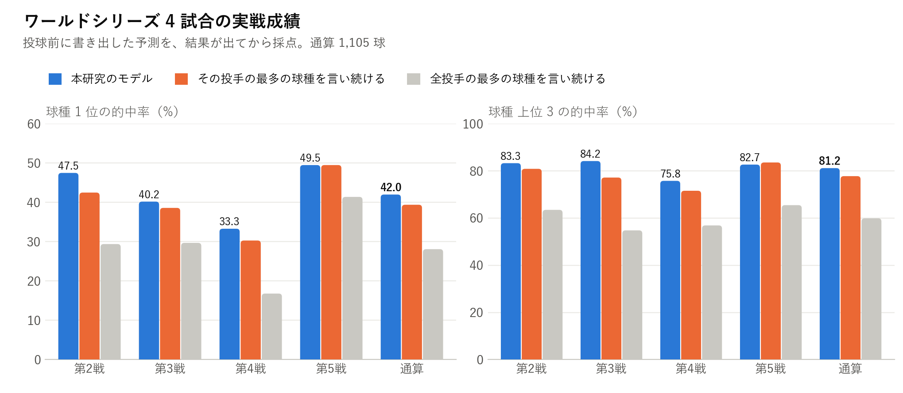

MLB 全体で多い答えよりはよく当たっていますが、投手ごとの傾向をそのまま答える方法には勝てませんでした。球種を 1 つ挙げる場合の差は +1.4 ポイントで、誤差の範囲です（95% 信頼区間 −1.9〜+4.9）。3 つ挙げる場合は −5.8 ポイントで、はっきり負けています（同 −8.6〜−3.0）。コースも上回っていません。

一番の原因として疑っているのは、モデルに渡した情報です。実戦で動かした版には、今の打席の前の球、その日の投球数、点差といった試合中の情報を渡せていませんでした。同じモデルに情報を全部渡したテストでは、2026 年のポストシーズン（10 月 17 日まで）で球種を 1 つ挙げて 46.2%、3 つ挙げて 88.0% 当たり、その日までの傾向どおりに答える場合（41.0%、85.4%）を上回っています。ただ、これは別の球での比較なので、同じ球で渡す情報だけを変えて確かめるのが次の作業です。

### 間に合ったか

テレビや配信の映像は、実際の試合より遅れて届きます。MLB.TV で第 4 戦を測ったところ、遅れは 24〜27 秒でした。

一方、投球が終わってから次の球の予測が出るまでは約 22 秒です。ほとんどは MLB がデータを公開するのを待つ時間で、こちらの計算は約 1.7 秒で終わります。次の球が投げられるのは前の球が終わった約 19 秒後で、映像に映るのはそのさらに 24〜27 秒後なので、予測のほうが約 21 秒早く画面に出ます。

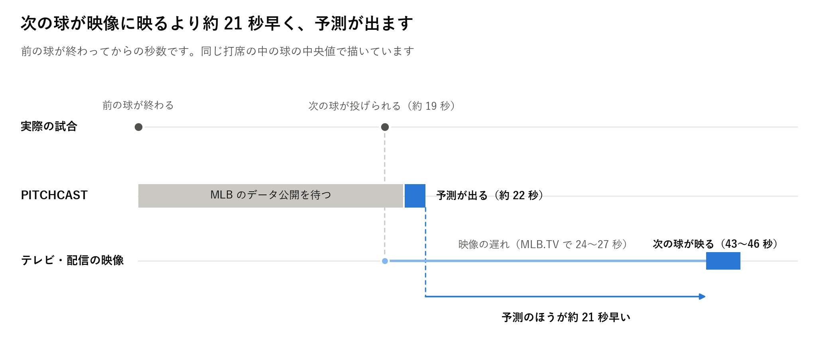

投げられた 1,257 球のうち、映像に映る前に予測を出せたのは 1,098 球（87.4%）でした。残りは主に、MLB が 2 球分のデータをまとめて公開して、次の球の予測を出す間がなかった球です（131 球）。

---

## 先行研究との比較

球種予測の正解率は、選択肢の数やデータの分け方で全然違う数字になるので、論文の数字をそのまま並べても比較になりません。同じモデルでも、選択肢を減らすだけで正解率はこれだけ上がります。

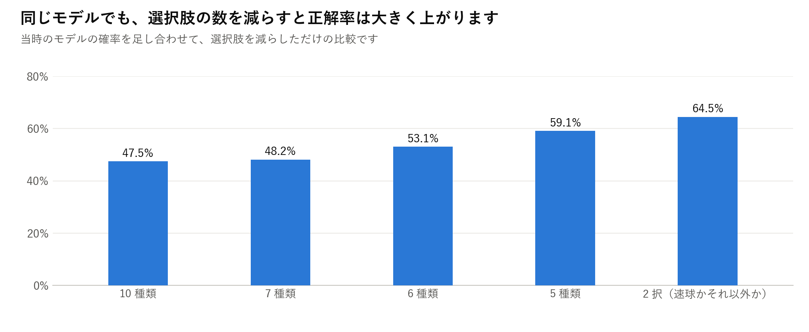

そこで、できるだけ条件を揃えて、相手の手法を自分のデータで動かすこともしながら比べました。

17 件を上回り、4 件は公表された数字に届かず、8 件は指標や使う情報が違って比較できませんでした。主なものを載せます。

| 比べた相手 | 問題 | 相手の正解率 | この研究の正解率 |
|---|---|---|---|
| Ahn ら 2026 | 速球かそれ以外か | 63.7% | **65.7%** |
| FanGraphs 2021 | 球種 7 種類、全投手 | 46〜48% | **50.4%** |
| 投手ごとに専用モデルを作る従来の手法（自分のデータで再現） | 速球かそれ以外か、220 投手 | 60.1〜60.5% | **65.3%** |
| Ahn ら 2026 | ポストシーズンのスイング判断（ストライクゾーンの内／外） | 76.6% ／ 79.2% | **79.0%** ／ **81.4%** |

届かなかった 4 件は、投手別の 2008〜2012 年の研究（70〜83%）、Morehouse 2019（51.4%）、Yu ら 2022（76.7%）、Lee 2022（62.4%）です。前の 2 つは、手法を再現して比べると上回ります。

Ahn らのモデルは約 30 億パラメータで、大規模な計算機で学習しています。こちらは 1 モデルが 200〜300 万パラメータで、家庭用 PC 1 台で学習できます。

---

## 使った技術

| 分類 | 内容 |
|---|---|
| 機械学習 | Python、PyTorch、Transformer、GRU、Mixture Density Network、勾配ブースティング木、アンサンブル、確率の較正 |
| データ処理 | pandas、PyArrow（Parquet）、pybaseball |
| システム | Streamlit、Plotly、MLB Stats API のライブデータ接続、常駐の記録プログラム |
| 品質管理 | pytest、ruff、自作の回帰チェック、実験ログ |
| 計算環境 | 家庭用 PC 1 台（Windows 11、Ryzen 7 5700X、メモリ 32 GB、RTX 4070） |

---

## 言葉の説明

| 言葉 | 意味 |
|---|---|
| 打席 | 1 人の打者が投手と対戦するひと区切り。数球からなります |
| 球種 | スライダーやシンカーなど、投球の種類 |
| 4 シーム | いわゆるストレート。MLB でいちばん多く投げられる球種です |
| コース | ボールがホームベースの上を通る位置。内角と外角、高めと低めなど |
| カウント | ボールとストライクの数の組み合わせ |
| ファウル | 打球が規定の区域の外へ飛び、試合が続かないこと |
| ポストシーズン | レギュラーシーズンの後に行われる、優勝を決めるまでの試合 |
| ワールドシリーズ | MLB の優勝チームを決める最終決戦 |
| 95% 信頼区間 | データのばらつきを考えると、本当の値がおよそこの範囲にあると考えられる区間 |

---

## クレジットとデータの権利

- マルチタスク学習の基盤部分は、公開実装 [carside71/atbat-dynamics-model](https://github.com/carside71/atbat-dynamics-model) を出発点としています。投球予測、時間への適応、統合、観戦システム、検証の仕組みはこの研究で追加したものです。
- 予測の順番の図とモデルの全体像の図は、[Qiita の打席結果予測の記事](https://qiita.com/nffrrf0701/items/ab1bd5ad90b8773dbff7)の図の構成を参考に自作しました。
- 投球と打球の計測データは、MLB Advanced Media が公開する [Statcast](https://baseballsavant.mlb.com) に基づいています。球審と気象の検証には [Retrosheet](https://www.retrosheet.org) が無償で提供する情報を使いました。The information used here was obtained free of charge from and is copyrighted by Retrosheet. Interested parties may contact Retrosheet at "www.retrosheet.org".
- 試合データの権利は MLB Advanced Media にあり、個人による非商用の利用に限って許諾されています。研究目的の利用にとどめ、取得の間隔を抑え、取得した生データを再配布していません。観戦システムも公開運用はしていません。
