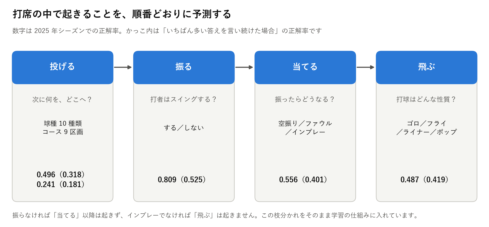
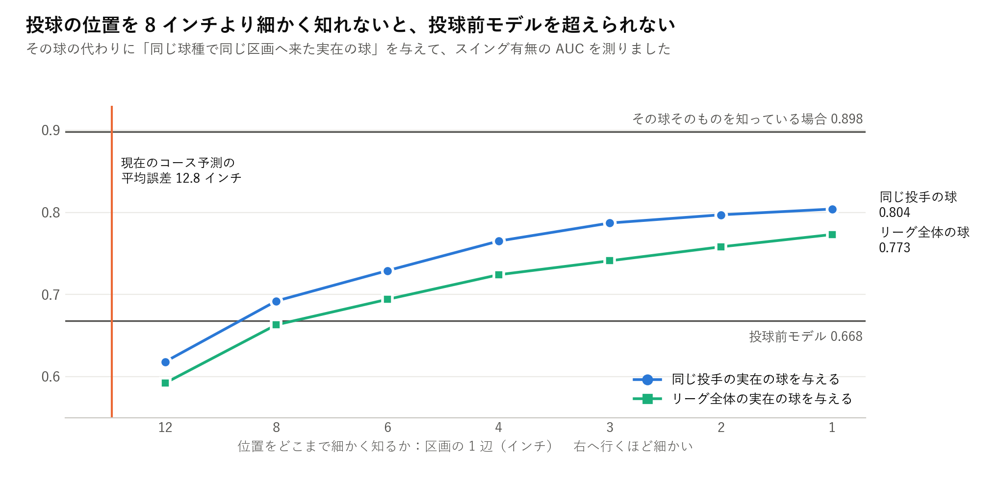
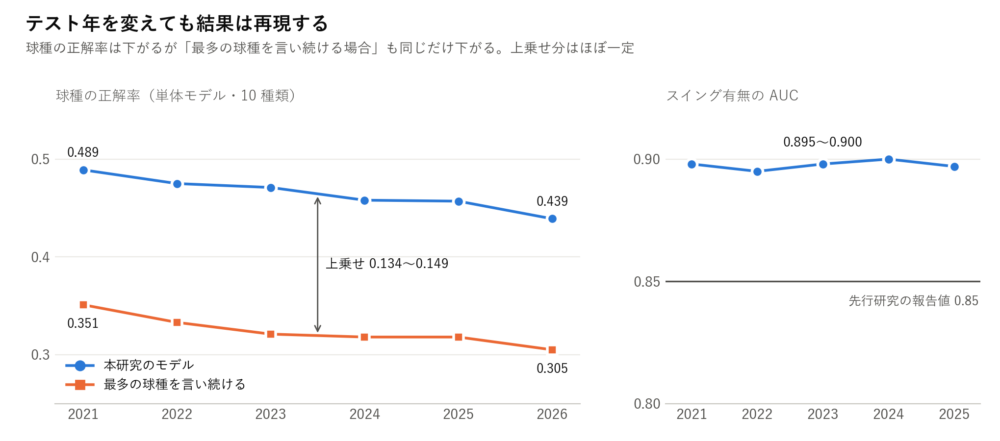
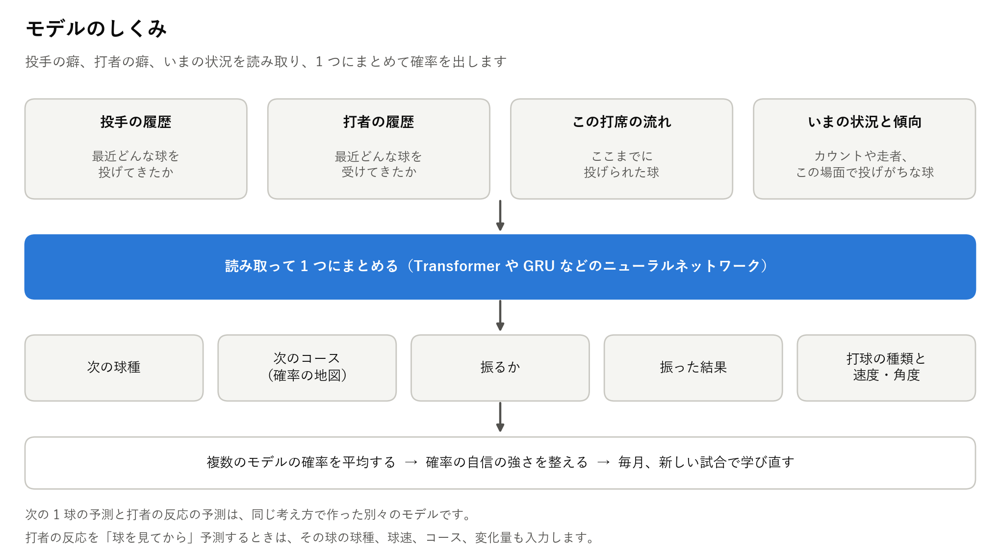
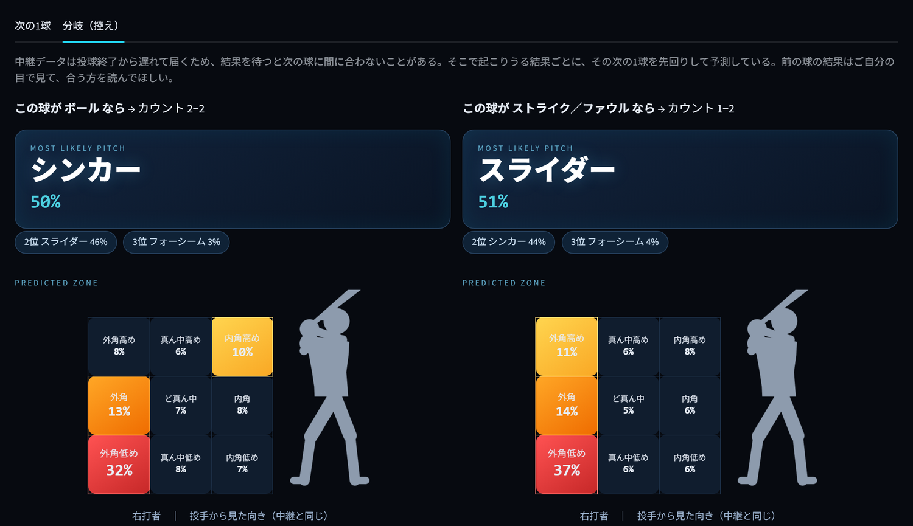

# baseball-realtime-forecast — 研究紹介

**MLB（アメリカのプロ野球）の「次の1球」を AI が予測し、その読みを観戦の楽しみに変える修士研究です。**

> 📌 **このリポジトリについて**
> 本リポジトリは研究内容と成果を紹介するためのものです。
> 研究成果の対外発表前であるため、指導教員の方針により**ソースコード・実験データは非公開**としています。
> 実装・実験・ドキュメントはすべて個人開発で行っています。
>
> 進捗の経緯と今後の計画は **[PROGRESS.md](PROGRESS.md)** にまとめています。

自作の観戦システム PITCHCAST の画面です。2026 年ワールドシリーズ第 2 戦 7 回表の実際の場面を再現しました。この球は実際にスライダーで外角低めへ来ました。分かりやすい例として当たった場面を選んでいて、いつもこのように当たるわけではありません（4 試合通算の球種の的中率は 42.0% です）。公開用に、打者のアイコンを差し替えています。

野球や機械学習の用語は、[ページの下の方](#言葉の説明)で説明しています。

---

## この研究の要点

- **作ったもの**: MLB の計測データ約 597 万球から、打席の中で起きること（次の球種とコース、打者が振るか、振った結果、打球）を予測するモデルを作りました。さらに、その予測を試合中に表示する観戦システム PITCHCAST を作りました。
- **精度**: 学習に使っていない 2025 年シーズンで、次の球種は 10 種類の中から 49.6%（候補を 3 つ挙げれば 91.3%）、打者が振るかどうかは球を見てから 80.9% 当たります。
- **先行研究との比較**: 条件を揃えて比べ、17 件を上回りました。公表された数値に届かない 4 件と、比較できない 8 件もそのまま示しています。
- **実際の試合**: 2026 年ワールドシリーズの 4 試合、1,257 球で、投げられる前に予測を記録しました。配信の視聴者が球を見る前に予測が出ていた割合は 87.4〜97.7% です（数え方で変わります）。
- **正直な結果**: 実戦の球種の的中率は 42.0% で、「その投手の最多の球種を言い続ける」方法の 39.4% との差は、この試合数では統計的に確かとは言えません。

---

## どんな研究か

野球は、投手と打者の 1 対 1 の対決の積み重ねです。次は何を投げるのか、打者は振るのか、振ったらどうなるのか。試合を観ている人が毎球のように考えるこの問いに、AI はどこまで答えられるのでしょうか。

この研究では、MLB が公開している 1 球ごとの計測データを使って、打席の中で起きることを予測する AI を作っています。さらに、その予測を試合中に画面へ表示する観戦システムも作り、実際の試合で動かしました。

目指しているのは、結果を言い当てることだけではありません。**AI の読みを見ながら「次の1球」を一緒に考える、新しい観戦の楽しみ方**を作ることです。そのために、どこまで当てられるかと同じくらい、何が精度を決めているのかを調べています。

---

## 何を予測しているのか

打席の中では、「投げる → 振る → 当てる → 飛ぶ」の順に出来事がつながっています。この流れに沿って、次に何が起きるかを予測します。

予測は「スライダー」と 1 つに言い切るのではなく、「スライダーが 51%、シンカーが 44%」のように**確率**で出します。野球には偶然がつきものなので、どれくらい起こりそうかを正直に示すほうが、観る人の役に立つと考えているからです。

もう 1 つ大事なのが、予測する**時点**の違いです。球を見てからなら、その球の球種やコースが分かります。観戦中に本当に使える「球が来る前」の予測では、それが分かりません。

---

## 結果

数値は、2024 年 6 月までのデータで学習し、2024 年後半で設定を調整したうえで、学習に使っていない 2025 年シーズン（約 65〜66 万球）で評価したものです。たとえば 0.809 は、100 球中およそ 81 球当たるという意味です。

| 予測するもの | 選択肢 | 本研究 | 比べる基準 |
|---|---|---|---|
| 次の球種 | 10 種類 | **0.496** ／ 上位 3 つ **0.913** | いつも 4 シームと答える 0.318 |
| 次のコース | 9 区画 | **0.241** ／ 上位 3 区画 **0.534** | リーグ全体の分布 0.181 ／ 0.430 |
| 打者が振るか（球を見てから） | 2 択 | **0.809**（AUC 0.898） | 多い方を答え続ける 0.525 |
| スイングの結果 | 3 択 | **0.556** | いちばん多い答えを言い続ける 0.401 |
| 打球の種類 | 4 択 | **0.487** | いちばん多い答えを言い続ける 0.419 |
| 打球速度／打球角度 | 連続量 | R² **0.315** ／ **0.203** | 平均を答え続ける 0 |
| 打者が振るか（球が来る前） | 2 択 | **0.619**（AUC 0.669） | 多い方を答え続ける 0.525 |

- **球種**: 出している確率も信用できる水準です（ECE 0.014）。「70% と言ったら本当に 7 割起きる」に近いということです。なお、0.496 はモデルの組み合わせをテストの成績も見て選んだので、わずかに楽観的な値です。検証データだけで選ぶと 0.492 です。
- **コース**: 「実際に投げられた球種を教えてもらってからコースを当てる」基準（0.219 ／ 0.531）を、球種を知らない状態で上回りました。

---

## 分かったこと

### 下の段階ほど、偶然が大きい

スイング有無は 0.809 まで当たるのに、打球の種類は 0.487 にとどまります。同じように打ち返しても、ゴロになるときとライナーになるときがあるからです。たとえばライナーは全打球の 24% を占めますが、どの状況でもゴロかフライの確率のほうが少し高いので、1 位の答えとしてはほとんど選ばれません。確率としては正しいのに正解率は伸びない、という現象です。

主要な改良のあと、さらに 27 通りの工夫を試しましたが、はっきり効いたのは 1 つだけでした。学習データを 3 分の 1 にしても 2 倍にしても、学習を延ばしても精度は動きません。ですから、資源の不足が原因ではないと考えています。ただし、これは今の入力と構成での観測で、精度の上限を示したものではありません。

### 球種を抑えていたのは、配球の流行の変化

記憶力の高いモデルは、学習データでは 0.50 近くまで当たるのに、未来のデータでは 0.459 に落ちました。壁はモデルの力不足ではなく、選手の入れ替わりや配球の流行の変化だったのです。そこで、場面ごとの配球の傾向を入れ、さらに直近を重く数える集計と毎月の更新を加えて、0.472 から 0.496 まで伸ばしました。

### 読める投手と読めない投手がいる

全体の正解率が 0.50 に届かないのは、持ち球が多く配分も均等な、読みにくい投手が混ざっているためです。読みやすさはシーズンをまたいで続きます（投手ごとの正解率の相関 0.751）。前のシーズンの後半で 0.50 以上当たった投手に絞ると、次のシーズンでも 0.554 でした。カウントによっても違い、3-0 では 0.798 です。

確率の高い球に絞ると、正解率はさらに上がります。当時の統合モデル（全球で 0.489）では、半分の球に絞ると 0.60、1 割に絞ると 0.80 でした。全部は当てられなくても、**いつ信用してよいかは分かる**ということです。

### コースは、狙いが分かっていても当てきれない

全投球の 78.7% が区画の境界から 4 インチ以内に来るので、少しのずれで隣の区画になります。投手の制球のばらつきが 8 インチなら、狙いを完全に知っていても 9 区画の的中率の上限は 0.424 です。連続の位置で見ると、平均誤差は 12.77 インチで、投手の平均位置を答えるだけの場合（13.06 インチ）とほとんど変わりません。

### 球が来る前に、打者の反応はほとんど読めない

次の球の予測と打者の反応の予測をつなげば、球が来る前でも打者の反応を読めるはずです。ところが、つなぎ方を 5 通り試しても、スイング有無は 0.62 前後で変わりませんでした。

そこで、投球の位置をどこまで細かく知れば打者の反応が当たるようになるかを測りました。その結果、**位置をおよそ 8 インチ（約 20 cm）より細かく知れないと、つないでも投球前の専用モデルに勝てない**ことが分かりました。今のコース予測の誤差はこの条件を満たしていません。

投球前の予測の大部分はカウントの効果でもあります（投球前モデルの AUC 0.668 に対し、カウントだけで 0.640）。そのため、モデルが特別な読みをしているように見せないよう気をつけています。

### 結果は特定の年の偶然ではない

- **年度を変えても再現します。** 球種の正解率は年々下がりますが、「最多の球種を言い続ける」場合も同じように下がります。投手の持ち球が増えて問題が難しくなったためで、モデルの上乗せ分（0.134〜0.149）はほぼ一定です。これは単体モデルの値です。
- **モデルを作り直さなくても大きくは崩れません。** 4 年前の打者予測モデルをそのまま使っても、0.87 ポイントしか下がりません（AUC 0.890）。球種のほうは 1 年あたり約 0.8 ポイント下がります。投げられる球は時代とともに変わりますが、打者の反応の仕方はあまり変わらないようです。
- **学習で見ていない投手にも通用します。** 一度も見ていない投手 306 人でも、スイング有無は 0.810 でした。履歴がない最初のうちは 5 ポイントほど低いのですが、およそ 1 試合分の 50 球で回復します。

---

## 手法のしくみ

細かな設定は省いて、考え方だけ紹介します。

- **履歴を順番どおりに読む**: 投手が最近投げた球、打者が最近受けた球、この打席の流れを、文章を読むように順番のあるデータとして読みます（Transformer、GRU）。
- **場面ごとの傾向を数える**: 「この投手はこのカウントで何を投げがちか」を、その試合より前のデータだけで集計します。配球の流行は変わるので、直近の試合を重く数えます。
- **打席の流れどおりに学習する**: スイングしなかった球では、スイングの結果や打球の誤差を計算しません（階層的なマルチタスク学習）。
- **コースは確率の地図で出す**: 1 点を当てるのではなく、どこに来やすいかの分布を出します。球種ごとに地図を持ち、球種の確率で重ねて合成します。
- **違うモデルを混ぜて、確率を整える**: 性質の違う複数のモデルの確率を平均し（アンサンブル）、確率の自信の強さを検証データで調整します（較正）。同じモデルを増やすより、違う情報を見るモデルを混ぜるほうがよく効きました。
- **毎月、新しい試合で学び直す**: その月を先に予測してから、その月の正解でモデルを微調整します（逐次適応）。未来の情報が混ざらない順番で行います。

---

## 観戦システム PITCHCAST

ページの最初の画面が PITCHCAST です。進行中の試合のデータを自動で取り込み、次の 1 球について次のものを表示します。

- **球種の予測**: 確率の高い順に 3 つ表示します。
- **コースの予測**: ストライクゾーンとその周りを 9 つの区画に分けて、来やすい場所を色で示します。
- **予測の理由**: カウントと投手のこれまでの実績から組み立てた短い文章です。モデルの内部を説明しているわけではありません。

### 最大の壁は時間

予測は、視聴者が次の球を見る前に出ていなければ意味がありません。ところが、MLB のデータは投球が終わってから中央値で 19.5 秒遅れて公開され、次の球までの間隔も 20.9 秒しかありません。モデルの計算そのものは約 13 ミリ秒なので、遅れの大半は MLB 側のデータの公開待ちです。

この壁には、次の 2 つで対処しました。

- **映像の遅れを測る**: テレビや配信の映像は、実際の試合より遅れて届きます（MLB.TV の実測で 24.3〜28.5 秒）。この遅れがそのまま猶予になります。遅れは配信によって違い、試合中にも動くので、映像で投手がボールを離した瞬間にボタンを数回押すだけで測れる仕組みを作りました。
- **分岐予測**: 前の球の結果を待たず、「ボールなら次はこれ」「ストライクならこれ」と、起こりうる結果ごとに先回りして予測して並べます。前の球の結果は観戦者が自分の目で見ているので、データの遅れの影響を受けません。

---

## 実際の試合で確かめた

2026 年のワールドシリーズで、**球が投げられる前に予測をファイルへ書き出し、結果が出てから採点する**評価（前向き評価）を行いました。あとからデータを分けて評価する方法と違い、未来の情報が混ざる余地がありません。使ったのは 2025 年 6 月までのデータで学習して固定した、計算の軽い単体モデルです。最良の 0.496 を出した統合モデルではありません。

第 1 戦は記録プログラムが起動されておらず取り逃がしました。試合前に自動で動く常駐型に作り直し、第 2〜5 戦の 1,257 球を記録しています。

### 当たったか

| 採点した 1,105 球 | モデル | その投手の最多を言い続ける | 全投手の最多を言い続ける |
|---|---|---|---|
| 球種 1 位 | **42.0%** | 39.4% | 28.1% |
| 球種 上位 3 つ | **81.2%** | 77.8% | 59.9% |
| コース 1 位 | **17.6%** | 17.0% | 16.2% |
| コース 上位 3 区画 | **42.7%** | 43.9% | 41.0% |

- **球種**: 投手別の最多を言い続ける方法との差は、1 位で +2.6 ポイント（95% 信頼区間 −0.3〜+5.5）です。区間が 0 をまたいでいるので、**この試合数では素朴な方法より良いとは言い切れません。** 上位 3 つの差は +3.3 ポイント（+0.3〜+7.0）です。
- **コース**: 素朴な方法と同じ水準で、優位は確認できませんでした。
- **理由の候補**: 計算の軽い単体モデルであること、ポストシーズンは投手の起用や配球が通常と違うこと、4 試合という少なさです。同じモデルの 2026 年シーズン全体の球種の値は、1 位 0.439、上位 3 つ 0.857 でした。

### 間に合ったか

| 投げられた全 1,257 球のうち | 割合 |
|---|---|
| 投球前の予測があった（直接の予測＋分岐予測） | 98.2% |
| 視聴者が見る前に出ていた（直接の予測だけ） | 87.4% |
| 視聴者が見る前に出ていた（分岐を含み、システムが枝を選ぶ） | 95.1% |
| 視聴者が見る前に出ていた（分岐を並べて、観戦者が枝を選ぶ） | 97.7% |

視聴者の映像の遅れは、MLB.TV の実測の代表値 24.5 秒で計算しています。MLB はときどき 2 球をまとめて公開するので、約 1 割の球は直接の予測が出せません。この穴は分岐予測が埋めました。

球場で観る場合は映像の遅れがないので、直接の予測が間に合うのは、予測があった 1,105 球のうち 57.2% にとどまります。分岐を並べる方式なら、観戦の場所によらず余裕があります。

---

## 先行研究との比較

球種予測の正解率は、選択肢の数、投手の絞り方、データの分け方でまったく別の数字になります。同じモデルでも、選択肢をまとめるだけで正解率は大きく上がります。そこで、数字をそのまま並べるのではなく、**相手の手法を自分のデータで動かす**などして条件を揃えて比べました。主な結果は次のとおりです。

| 比べた相手 | 問題 | 相手の値 | 本研究 |
|---|---|---|---|
| Ahn ら 2026（世界モデル） | 速球か否か | 0.637 | **0.657** |
| FanGraphs 2021（系列変換） | 球種 7 種類、全投手、時系列分割 | 0.46〜0.48 | **0.504** |
| 投手ごとに専用モデルを作る従来の手法（本研究のデータで再現） | 速球か否か、220 投手 | 0.601〜0.605 | **0.653** |
| Ahn ら 2026（世界モデル） | ポストシーズンのスイング判断（ゾーン内／外） | 0.766 ／ 0.792 | **0.790** ／ **0.814** |
| FanGraphs（xWhiff） | スイング／空振りの AUC | 0.85 ／ 0.78 | **0.898** ／ **0.821** |
| Takamido と Nakamoto 2026 | 2 ストライク時の最終球の AUC | 0.811 | **0.859** |

判定の内訳は次のとおりです。

- **上回った: 17 件**。手法を再現して比べたもの、査読を経ていないもの、僅差や注記つきのものも含みます。
- **公表された数値に届かない: 4 件**。投手別の 2008〜2012 年の研究（0.70〜0.83）、Morehouse 2019（0.514）、Yu ら 2022（0.767）、Lee 2022（0.624）です。前の 2 つは、手法を再現して比べると上回ります。
- **比較できない: 8 件**。指標が公表されていないものや、使う情報の範囲が違うもの（投手の身体の動きの映像を使う研究など）です。
- **比べる相手が見つからない問題: 2 つ**。投球前に全投手のコース分布を予測する問題と、打撃前に打球の種類を予測する問題です。調べた範囲の話で、存在しないと証明したものではありません。

計算資源の面では、約 30 億パラメータのモデルを大規模な計算機で学習する Ahn らに対し、本研究の 1 モデルは 200〜300 万パラメータで、家庭用 PC 1 台で学習できます。

---

## 既存のサービスとの違い

調査した範囲で近いものと比べると、次のように異なります。

| 近いもの | やっていること | 本研究との違い |
|---|---|---|
| 放送向けの配球 AI | 失点を抑えるのに最適な球種とコースを算出して表示する | 「どう投げるべきか」の推奨で、「何が投げられるか」の予測ではない |
| 放送の AI 統計 | 勝利確率や対戦成績を重ねて表示する | 試合単位の確率や記述統計で、1 球単位の予測ではない |
| 計測データの可視化サイト | プレーの後の分析を見せる | プレーの前の予測ではない |
| 個人開発の球種予測アプリ | 入力に対して球種を予測する | ライブの試合と連携していない。球種のみ |

本システムの特徴は、1 球単位の**予測**を、**投球の前に**、**確率として**、**実際の試合で**見せることです。

---

## 限界

- **使っているのは MLB の計測データだけです。** 投手の握り、捕手のサイン、身体の動きのような、データにない情報は扱えません。他のリーグで同じ精度が出るかも分かりません。
- **実戦テストは 4 試合だけです。** 素朴な方法との差を統計的に示すには足りません。また、最良の統合モデルは実戦に載せていません。
- **映像の遅れは 1 試合、1 つの配信でしか測っていません。** 他の配信では違う可能性があります。
- **年度別の検証は単体モデルです。** 最良の統合モデルでの年度別の検証は、これから行います。
- **観戦体験はまだ評価していません。** 予測が当たることと、観戦が楽しくなることは別の問題です。

---

## 大事にしていること

- **未来の情報を混ぜません。** 学習は過去のデータだけで行い、評価は学習に使っていない未来のシーズンで行います。履歴から作る情報も、その球より前のものだけを使います。試験の答えを見ながら勉強しても、実力は測れないのと同じです。
- **不自然に良い数字を疑います。** 良すぎる結果が出たら、喜ぶ前に原因を調べます。
- **条件を揃えて比べます。** ほかの研究の数字をそのまま並べず、できるだけ同じ条件で比べます。勝てなかった研究、比較できない研究もそのまま書いています。
- **限界を決めつけません。** 「ここが限界」と結論づけたあとに、別の方向から攻めて記録を更新したことが何度もあります。頭打ちは、試した範囲での観測として書いています。
- **うまくいかなかったことも記録します。** 試したことは、効かなかったものも含めて実験ログに残しています。

---

## 開発の進め方

- **実験管理**: 実験を「仮説 → 結果 → 考察」の形で実験ログに記録し、モデルレジストリで学習済みモデルと設定を追跡しています。
- **回帰テスト**: 基準モデルの評価指標を固定し、リファクタリングによる意図しない挙動の変化をコミット単位で検出する仕組みを作りました。
- **単体テスト**: pytest 64 件と回帰チェックで、変更の影響を確かめています。
- **学習の高速化**: bf16 混合精度（AMP）を導入して、学習を 1.36 倍に高速化しました。その過程で見つけたデータ型の不整合のバグも修正しています。
- **実戦での安定稼働**: 45 分の連続運転で失敗 0 件を確認し、途中で落ちても重複なく再開できるようにしました。更新を軽く確認してから本体を取りに行く方式で、1 試合の通信量を約 964 MB から約 35 MB へ減らしました。

---

## 使った技術

| 分類 | 内容 |
|---|---|
| 機械学習 | Python、PyTorch（CUDA、bf16 混合精度）、Transformer、GRU、Mixture Density Network、勾配ブースティング木（scikit-learn）、DeepFM、アンサンブル、確率の較正、逐次適応 |
| データ処理 | pandas、PyArrow（Parquet）、pybaseball |
| システムと可視化 | Streamlit、Plotly、MLB Stats API のライブデータ接続、常駐の記録プログラム |
| 品質管理 | pytest、ruff、自作の回帰チェック、実験ログ、モデルレジストリ |
| 計算環境 | 家庭用 PC 1 台（Windows 11、Ryzen 7 5700X、メモリ 32 GB、RTX 4070）、conda |

---

## 言葉の説明

### 野球の言葉

| 言葉 | 意味 |
|---|---|
| MLB | アメリカのプロ野球リーグ（メジャーリーグベースボール） |
| Statcast | MLB が全球場に導入している計測システム。球速やボールの位置などを 1 球ごとに記録しています |
| 打席 | 1 人の打者が投手と対戦するひと区切り。数球からなります |
| 球種 | スライダーやシンカーなど、投球の種類 |
| 4 シーム | いわゆるストレート。最も多く投げられる球種です |
| 持ち球 | その投手が投げる球種の組み合わせ |
| コース | ボールがホームベースの上を通る位置。内角と外角、高めと低めなど |
| カウント | ボールとストライクの数の組み合わせ。「3-0」は 3 ボール 0 ストライク |
| ファウル | 打球が規定の区域の外へ飛び、試合が続かないこと |
| インプレー | 打球が前に飛び、試合が続く状態になること |
| ポストシーズン | レギュラーシーズンの後に行われる優勝決定までの試合 |
| ワールドシリーズ | MLB の優勝チームを決める最終決戦 |

### 機械学習の言葉

| 言葉 | 意味 |
|---|---|
| 機械学習 | 大量のデータから規則を自動で学ぶ技術 |
| 学習データ、検証データ、テストデータ | 規則を学ぶデータ、設定の調整に使うデータ、最後の評価に使うデータ |
| 基準（ベースライン） | 比較に使う素朴な予測。いちばん多い答えを言い続ける、など |
| 正解率 | 予測が当たった割合 |
| AUC | 起こりやすい順に正しく並べられているかを表す指標。0.5 がでたらめ、1.0 が完璧です |
| R² | 平均を答え続ける場合と比べて、誤差をどれだけ減らせたかを表す指標。0 は平均と同じ、1 は完璧です |
| ECE | 予測した確率と実際の割合のずれの平均。小さいほど確率が信用できます |
| 95% 信頼区間 | データのばらつきを考えると、本当の値がおよそこの範囲にあると考えられる区間 |
| マルチタスク学習 | 複数の予測対象を 1 つのモデルで同時に学習すること |
| Transformer、GRU | 順番のあるデータを読むニューラルネットワークの種類 |
| Mixture Density Network | 1 つの値ではなく、確率分布を出力するニューラルネットワーク |
| 勾配ブースティング木 | 決定木をたくさん積み重ねるモデル。表の形のデータでよく使われます |
| DeepFM | 特徴どうしの組み合わせを扱うニューラルネットワーク |
| アンサンブル、統合 | 複数のモデルの予測を平均して使うこと。誤りが打ち消し合います |
| 単体モデル | 統合せず、1 つだけで動かすモデル |
| 較正 | 「70% と言ったことが本当に 7 割起きる」ように確率を合わせること |
| 逐次適応 | 新しいデータが来るたびにモデルを少しずつ更新すること |
| 前向き評価 | 予測を先に記録しておき、結果が出てから採点する評価 |
| 分岐予測 | 前の球の結果ごとに、次の球の予測を先回りして用意しておくこと |

---

## クレジットとデータの権利

- マルチタスク学習の基盤部分は、公開実装 [carside71/atbat-dynamics-model](https://github.com/carside71/atbat-dynamics-model) を出発点としています。投球予測、時間への適応、統合、観戦システム、検証の仕組みは本研究で追加したものです。
- 投球と打球の計測データは、MLB Advanced Media が公開する [Statcast](https://baseballsavant.mlb.com) に基づいています。球審と気象の検証には [Retrosheet](https://www.retrosheet.org) が無償で提供する情報を使いました。The information used here was obtained free of charge from and is copyrighted by Retrosheet. Interested parties may contact Retrosheet at "www.retrosheet.org".
- 試合データの権利は MLB Advanced Media にあり、個人による非商用の利用に限って許諾されています。本研究は研究目的の利用にとどめ、取得の間隔を抑え、取得した生データを再配布していません。観戦システムも公開運用はしていません。
